  

    

  

    

  

    
    
    
    
  

---

### 👨‍💻 About Me

* 🚀 **Engineering Focus:** Designing resilient, high-concurrency architectures with zero-compromise data integrity and low-latency execution.
* 🛠️ **Systems & Backend:** Specializing in transactional state engines, pessimistic locking mechanisms (ACID compliance), decoupled message/worker queues, and robust API orchestration.
* 🛡️ **Production Reliability & Security:** Applying OWASP hardening standards, in-memory sliding-window rate limiters, automated failover pipelines, and zero-downtime Linux server orchestration.
* 🎓 **Education:** Informatics Student at **Telkom University** (Class of 2026).

---

### 🌟 Featured Production Projects

<table>
  <tr>
    <td width="33.3%" valign="top">
      <h4>⚡ <a href="https://aeroflazz.com">Aeroflazz</a></h4>
      
<em>High-Throughput Digital Products & PPOB Distribution Platform</em>

      <ul>
        <li>Engineered transactional backend in Go with pessimistic locking (GORM v2) to guarantee balance integrity under concurrent spikes.</li>
        <li>Sub-second Next.js client with granular caching rules and Cloudflare CDN bypass layers.</li>
        <li>High-availability daemonized service management via Supervisor and PM2 on Linux VPS.</li>
      </ul>
      

        <a href="https://aeroflazz.com"><b>🌐 Live Platform</b></a>
      

      <b>Stack:</b> Go (Golang), PostgreSQL, Next.js, Supervisor, Nginx, Linux VPS
    </td>
    <td width="33.3%" valign="top">
      <h4>💳 <a href="https://paysaku.site">PaySaku</a></h4>
      
<em>Asynchronous Payment Processing & FinTech Application</em>

      <ul>
        <li>Asynchronous background transaction processing pipelines powered by Redis worker queues.</li>
        <li>Idempotent payment consumption, webhook verification, and automated transaction reconciliation.</li>
        <li>Strict defensive input validation and decoupled queuing architecture.</li>
      </ul>
      

        <a href="https://paysaku.site"><b>🌐 Live Platform</b></a>
      

      <b>Stack:</b> PHP 8.4, Laravel, Redis Queues, MySQL, Supervisor
    </td>
    <td width="33.3%" valign="top">
      <h4>🌾 <a href="https://github.com/riiardian/kertanusa">Kertanusa</a></h4>
      
<em>Precision Agriculture & AI-Driven Decision Support System (DSS)</em>

      <ul>
        <li>Real-time multimodal computer vision pipeline for automated plant pathology and pest diagnosis.</li>
        <li>Satellite agrometeorology integration (ECMWF, NOAA, BMKG) for dynamic spray windows and soil water balance (FAO No. 56).</li>
        <li>OWASP security hardened with in-memory sliding-window rate limiting.</li>
      </ul>
      

        <a href="https://kertanusa.web.id"><b>🌐 Live Prototype</b></a> • 
        <a href="https://github.com/riiardian/kertanusa"><b>💻 Repository</b></a>
      

      <b>Stack:</b> Next.js 15, TypeScript, Tailwind CSS, Multimodal Vision AI, Leaflet GIS
    </td>
  </tr>
</table>

---

### 💻 Tech Arsenal

  

 

| Domain | Technologies & Tools |
| :--- | :--- |
| **Languages** | Go (Golang), TypeScript, JavaScript, PHP, SQL, Python |
| **Frontend & UI** | Next.js 15 (App Router, Turbopack), React, Tailwind CSS |
| **Backend & Architecture** | RESTful APIs, Event-Driven / Worker Queues, GORM, Laravel, Idempotent Engines |
| **Databases & Caching** | PostgreSQL, MySQL, SQLite, Redis |
| **DevOps & Infrastructure** | Linux (Debian/Ubuntu), Nginx Reverse Proxy, PM2, Supervisor, Docker, Cloudflare |
| **Security & Standards** | OWASP Hardening (HSTS, CSP), Anti-Race Condition, Input Sanitization, Rate Limiting |

---

### 📊 GitHub Activity & Metrics

  
  

  

---

  Designed & engineered with clean code principles. © 2026 Rio Ardian Pratama

