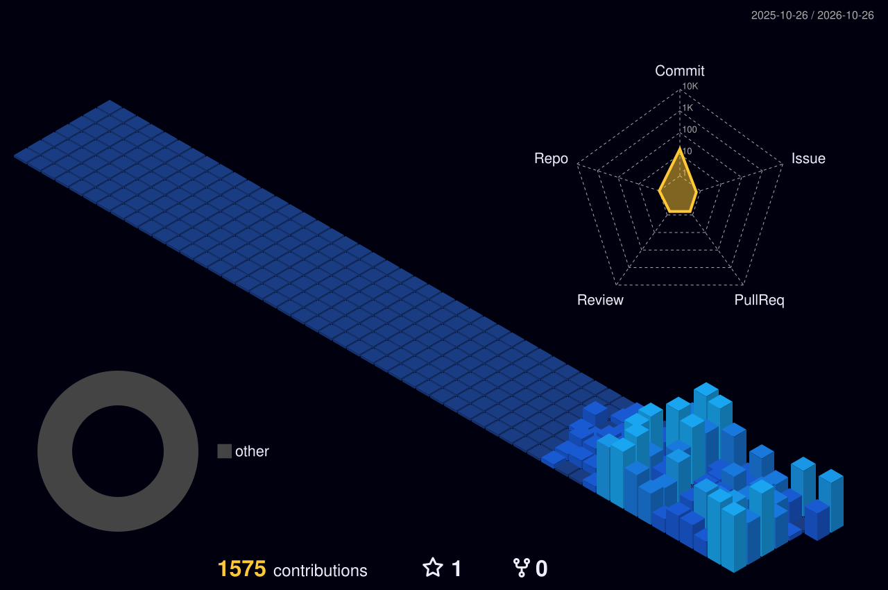

  <h1 align="center">Rio Ardian Pratama</h1>
  

    <strong>Systems Architect &amp; Backend Engineer</strong> 
    High-Concurrency Infrastructure &amp; Transactional Systems
  

  

    

  

    
    
    
    
  

---

### About Me

Software engineer berbasis di Tangerang yang berfokus pada arsitektur sistem backend, pemrosesan transaksi finansial, dan kehandalan infrastruktur Linux. Menempuh studi Teknik Informatika di Telkom University sembari aktif membangun serta mengoperasikan platform digital mandiri berskala produksi.

Bekerja utamanya dengan **Go (Golang)**, **Rust**, dan **Next.js**, dengan perhatian khusus pada integritas data, efisiensi resource server, dan stabilitas layanan saat menangani lonjakan transaksi nyata.

---

### Featured Projects

#### AeroFlazz — Platform Distribusi Digital &amp; PPOB Otomatis
Platform agregator produk digital dan layanan PPOB yang melayani transaksi pulsa, paket data, token listrik, voucher game, hingga nomor virtual OTP secara otomatis selama 24 jam.

Teknologi: `Go (Fiber v2)` / `PostgreSQL` / `Redis` / `Next.js 16` / `TypeScript` / `Nginx`

Tautan: [Website Resmi (aeroflazz.com)](https://aeroflazz.com) | [Tentang Pengembang](https://aeroflazz.com/tentang-kami)

---

#### PaySaku — Payment Gateway QRIS &amp; Otomasi Mutasi Merchant
Gerbang pembayaran digital real-time berbasis Rust untuk rekonsiliasi mutasi otomatis multi-channel (GoBiz dan ShopeePay Merchant) guna mendukung settlement transaksi instan.

Teknologi: `Rust (Tokio / Axum)` / `React 19` / `TypeScript` / `PostgreSQL` / `Tailwind CSS`

Tautan: [Website Resmi (paysaku.site)](https://paysaku.site) | [Dokumentasi API](https://paysaku.site/docs)

---

#### Kertanusa — Platform Telemetri &amp; AI Presisi Pertanian
Sistem pendukung keputusan pertanian presisi yang memadukan integrasi data satelit cuaca global (ECMWF, NOAA, BMKG) dan visi komputer untuk diagnosis kondisi tanaman.

Teknologi: `Next.js` / `TypeScript` / `Tailwind CSS` / `Vision AI` / `Leaflet GIS`

Tautan: [Repositori GitHub (riiardian/kertanusa)](https://github.com/riiardian/kertanusa)

  

---

### Security Architecture &amp; System Hardening

Infrastruktur dan engine transaksi produksi dirancang dengan standar keamanan enterprise:

`Zero-Trust Perimeter` Cloudflare Strict SSL, mTLS, dan perisai reverse proxy Nginx yang terisolasi untuk menangkal serangan perimeter.

`Kriptografi Asimetris Ed25519` Tanda tangan digital standar SNAP BI / FAPI untuk non-repudiation mutasi merchant tanpa menyimpan private key di server.

`Double-Entry Ledger Engine` Pembukuan berpasangan dengan verifikasi zero-sum matematis otomatis untuk mencegah saldo gantung atau desinkronisasi.

`Anti-Race Condition Concurrency` Penguncian pesimistik tingkat baris database dan Redis Distributed Mutex untuk mencegah double-spend attack saat traffic tinggi.

`Defensive Hardening Pipeline` Proteksi sesi HttpOnly cookie anti-XSS, sanitasi URL callback OAuth, dan pencegahan SSRF pada webhook dispatcher.

---

### Tech Stack &amp; Tools

  

 

| Bidang | Teknologi |
| :--- | :--- |
| **Bahasa Pemrograman** | Go (Golang), Rust, TypeScript, JavaScript, SQL, Python |
| **Backend &amp; Arsitektur** | Fiber, Axum, Tokio Async, RESTful API, Microservices, Worker Queues |
| **Frontend &amp; UI** | Next.js (App Router), React, Tailwind CSS |
| **Basis Data &amp; Caching** | PostgreSQL, MySQL, Redis, SQLite |
| **DevOps &amp; Server** | Linux (Debian/Ubuntu), Nginx Reverse Proxy, PM2, Supervisor, Cloudflare Edge |

---

### 3D Contribution Architecture

  

 

  

---

  © 2026 Rio Ardian Pratama

